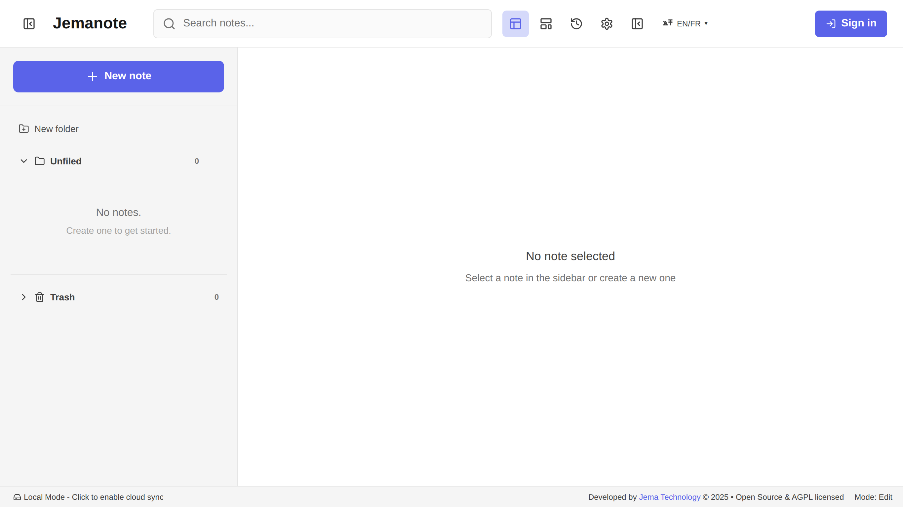
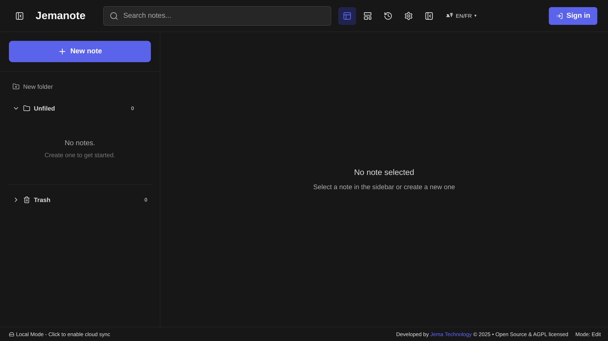
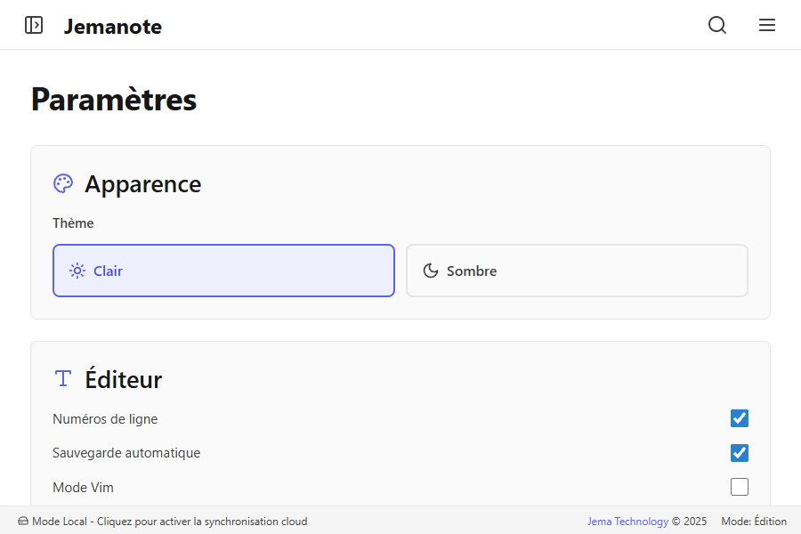

<div align="center">


# JemaNote

### Your second brain — Markdown notes, graph view and AI, offline-first

[](https://www.jematechnology.fr)
[](LICENSE)
[](https://react.dev)
[](https://www.typescriptlang.org)
[](https://vitejs.dev)
[](https://storybook.js.org)
[](#-getting-started)
[](#-contributing)

**Markdown · wiki-links · graph & canvas · Mermaid · KaTeX · AI · cloud sync (optional)**

[Features](#-features) · [Screenshots](#-screenshots) · [Getting started](#-getting-started) · [Tech stack](#-tech-stack) · [License](#-license)

</div>



---

## 📝 About

JemaNote is a note-taking **Progressive Web App** built by [Jema Technology](https://www.jematechnology.fr). It delivers a fluid experience with full Markdown support, optional cloud sync, and advanced features like a knowledge graph, canvas view and AI assistance — all working offline.

## ✨ Features

### ✍️ Editor

- Complete **Markdown** editor with live preview
- Syntax highlighting powered by **CodeMirror**
- **KaTeX** math formulas
- **Mermaid** diagrams
- **WikiLinks** to connect your notes

### 🗂️ Organisation

- Folder system
- Fast, powerful search (**Fuse.js**)
- Trash with restore
- Date-based **timeline** view

### 🕸️ Visualisation

- **Graph view** of note connections (**Cytoscape**)
- **Canvas view** for spatial organisation (**PixiJS**)

### 🤖 AI

- AI assistance via **Mistral** (your own account, no visible key)
- Automatic summaries
- Writing assistance

### ☁️ Sync & storage

- Local-first storage (**LocalForage**)
- Optional **cloud sync** (Supabase)
- Full **offline** mode (PWA)

### 🎨 Interface

- Light / dark theme (follows the OS)
- Responsive design (mobile, tablet, desktop)
- **Command palette** (`Ctrl/Cmd + K`)
- Voice recording

---

## 📸 Screenshots

|                           Light                           |                             Dark                              |
| :-------------------------------------------------------: | :-----------------------------------------------------------: |
|  |  |

<p align="center">
  
</p>

---

## 🚀 Getting started

### Prerequisites

- [Node.js](https://nodejs.org) 18+
- npm

### Install & run

```bash
git clone https://github.com/JemaOS/jemanote.git
cd jemanote
npm install
npm run dev
```

### Build

```bash
npm run build       # production build
npm run preview     # preview locally
```

### Environment variables

Create a `.env` file (all optional — the app runs fully in **local mode** without any config):

```bash
# Supabase (optional — enables cloud sync)
VITE_SUPABASE_URL=...
VITE_SUPABASE_ANON_KEY=...
```

### Tests & quality

```bash
npm test            # unit tests (Vitest)
npm run type-check  # TypeScript
npm run lint        # ESLint
npm run test:e2e    # end-to-end tests (Playwright)
npm run storybook   # component playground
```

---

## 🛠️ Tech stack

- **React 18** + **TypeScript** + **Vite**
- **CodeMirror 6** editor, **Mermaid**, **KaTeX**
- **Cytoscape** (graph) & **PixiJS** (canvas)
- **Radix UI** + **TailwindCSS**
- **LocalForage** (local) · **Supabase** (optional sync)
- **Mistral** AI integration
- **Vitest**, **Playwright**, **Storybook**

---

## 🤝 Contributing

Contributions are welcome! Fork, branch, and open a pull request.

```bash
git checkout -b feat/my-feature
git commit -m "feat: my feature"
git push origin feat/my-feature
```

---

## 📄 License

Released under the **GNU AGPL-3.0** — see [LICENSE](LICENSE).

<div align="center">
Made with ❤️ by <a href="https://www.jematechnology.fr">Jema Technology</a>
</div>
